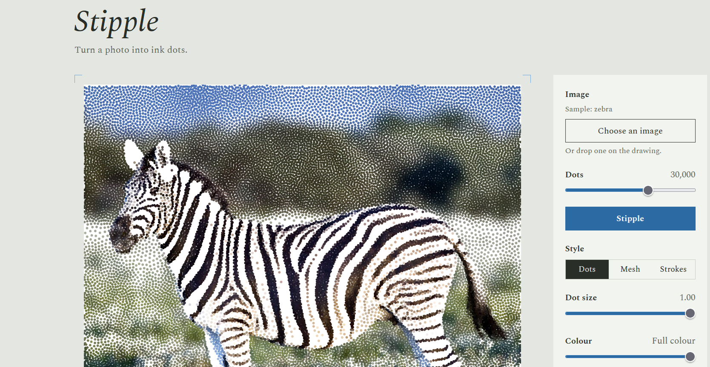

# stipple

[](https://adecacqueray.github.io/stipple/)
[](https://pypi.org/project/blue-sampler/)

Stippling images with dots using [recursive gaussian blue noise](https://github.com/For-a-few-DPPs-more/Recursive-Gaussian-Blue-Noise).

## Live demo:

**▶ [adecacqueray.github.io/stipple](https://adecacqueray.github.io/stipple/)**

## To run localy:

```sh
rustup target add wasm32-unknown-unknown
./build.sh                      # compiles src/ to web/stipple.wasm
python3 -m http.server          # then open http://localhost:8000
```

## Acknowledgments

This builds on **Gaussian Blue Noise** by Abdalla G. M. Ahmed, Jing Ren and Peter Wonka, *ACM Transactions on Graphics* 41(6), Proc. SIGGRAPH Asia 2022 ([arXiv:2206.07798](https://arxiv.org/abs/2206.07798)).

```bibtex
@article{ahmed2022gaussian,
  title   = {Gaussian Blue Noise},
  author  = {Ahmed, Abdalla G. M. and Ren, Jing and Wonka, Peter},
  journal = {ACM Transactions on Graphics},
  volume  = {41},
  number  = {6},
  year    = {2022}
}
```



Sample photo (zebra, default image): [Yathin S Krishnappa](https://commons.wikimedia.org/wiki/File:Equus_quagga_burchellii_-_Etosha,_2014.jpg), [CC BY-SA 3.0](https://creativecommons.org/licenses/by-sa/3.0/), via Wikimedia Commons (resized and stippled).
